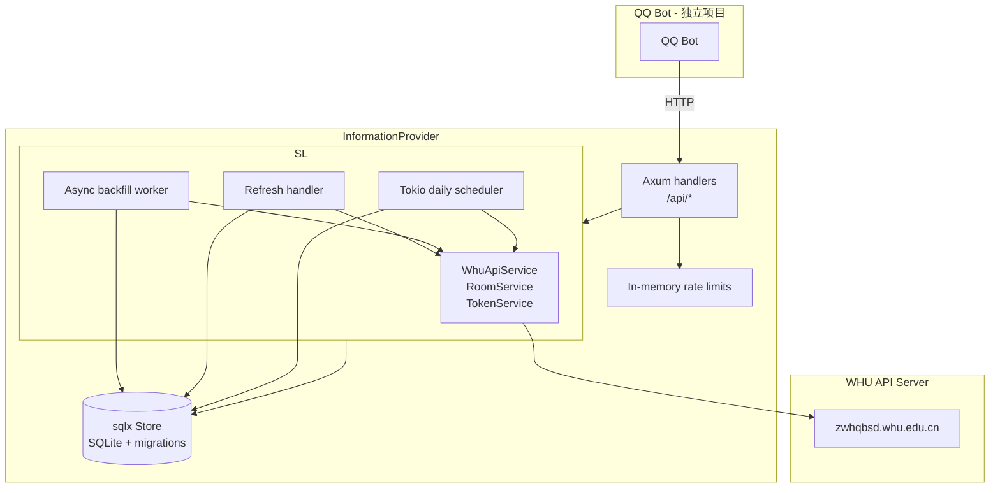

# Design Details

## 架构总览

## 关键流程

### 订阅流程

1. QQ Bot 发送 `POST /api/rooms { "roomId": "xxx" }`
2. Axum handler 验证房间号并调用 WHU 查询电表信息
3. handler 获取当前余额，并在单个数据库事务中创建 Subscription、BackfillJob 和初始 DailyBalanceRecord
4. 持久化成功后启动异步回填并返回 `202 Accepted`，`Location` 指向任务状态端点
5. Backfill worker：
   - `chunkEnd = yesterday`（当天的数据尚未产生）
   - while True:
     - `chunkStart = chunkEnd - 99 days`（每块 100 天）
     - 调用 `GetMeterDayValue(meterId, chunkStart, chunkEnd)` 批量拉取
     - 返回空 → break（已穷尽历史数据）
     - 以 `(RoomId, Date)` 唯一键 upsert 到 `DailyUsageRecord`
     - 找到返回记录中的最早日期 → `chunkEnd = 最早日期 - 1 day`
   - 回填结束后再次调用 `GetReserve(meterId)` 更新余额快照并将任务标记为 completed
6. 客户端通过 `GET /api/rooms/{roomId}/backfill` 查询任务状态

### 定时任务流程

1. Tokio 调度器按 Asia/Shanghai 时区在凌晨 2:00 触发
2. 从 DB 读取所有 Subscription
3. 对每个 RoomId 并行（最多同时 5 个）：
   - 调用 `GetMeterDayValue(meterId, yesterday, yesterday)` → 写入 DailyUsageRecord
   - 调用 `GetReserve(meterId)` → 写入 DailyBalanceRecord
4. 失败的任务加入重试队列，15 分钟后重试

### 查询流程（余额/日用量/趋势）

1. QQ Bot 发送 GET 请求
2. handler 检查进程内限频状态：
   - 超出 → 返回 429
3. handler 从 sqlx Store 读取数据
4. 有数据 → 200 + 数据
5. 无数据 → 404

## 限频实现

限频状态保存在单进程内存中，按 `roomId + endpointType` 限制余额、日用量和趋势查询；刷新使用独立的 `roomId` 限制键。进程重启后限频记录会重置，因此部署必须保持单实例。

## 配置

服务从环境变量读取 WHU 账号、SQLite URL、查询/刷新限频间隔、调度时间、重试间隔、并发数和回填区间大小。变量名与默认值见 [Operations](./operations.md#配置)。
